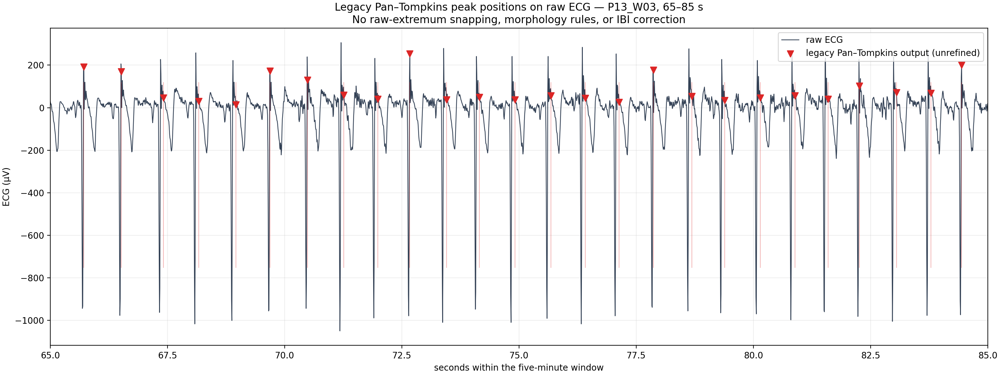
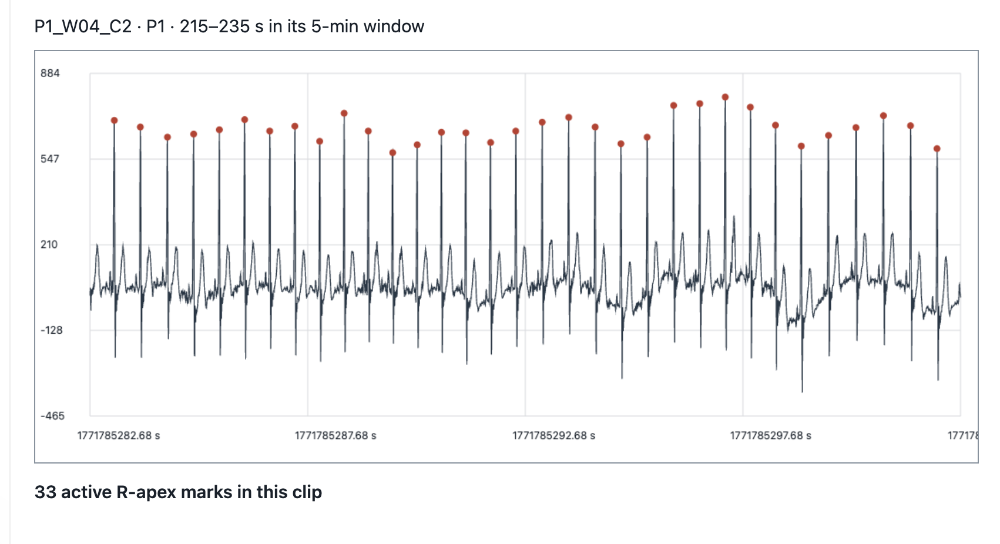
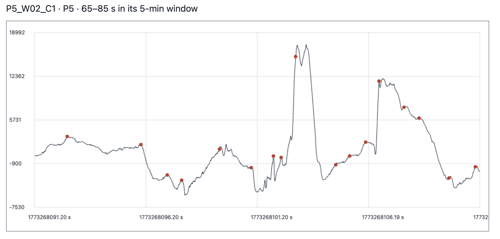
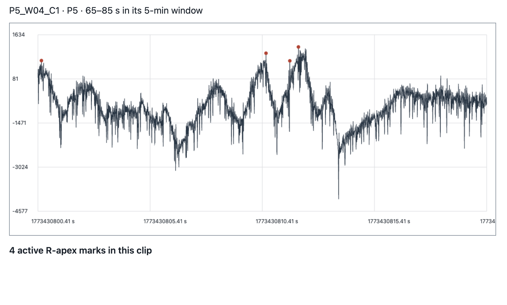

# ECG Label Audit and Candidate Rebuild

## Previous ECG RMSSD Label

The previous ECG target was `ecg_rmssd_corrected_ms`. Its label-generation
pipeline was:

1. Compute RR intervals from Pan–Tompkins peaks.
2. Retain only IBIs in the physiological range of 300–2000 ms.
3. If an IBI differs from its 11-point local median by more than 20%, replace
   it with that local median.
4. Compute RMSSD on the corrected IBI sequence.

## Independent Blinded Raw-ECG Audit

An independent, blinded raw-ECG review was conducted.

- The audit covered 16 five-minute windows from four participants in the
  released training cohort: `P1`, `P5`, `P13`, and `P15`.
- Two 20-second excerpts were drawn from each window (65–85 s and 215–235 s),
  for **32 excerpts** in total.
- Reviewers inspected raw ECG and clicked each R apex. The interface showed no
  detector markers, predicted peaks, or RMSSD values.
- This produced **680 manual R-apex annotations**. Pan–Tompkins was run on the
  complete five-minute windows; its events were then compared with manual
  apices only within the blinded excerpts.
- Detector and manual R apices were matched one-to-one using a pre-specified
  150 ms tolerance. This tolerance is used only for event counting; **it does
  not mean that a 150 ms location error is acceptable for RMSSD**.

### Pan–Tompkins Events Are Not Located at the Raw R Apex

| Timing reference | Tolerance | Precision | Recall | F1 |
|---|---:|---:|---:|---:|
| Raw Pan–Tompkins | ±10 ms | 1.17% | 1.32% | 1.24% |
| Raw Pan–Tompkins | ±20 ms | 1.56% | 1.76% | 1.66% |
| Raw Pan–Tompkins | ±40 ms | 18.18% | 20.59% | 19.31% |
| Raw Pan–Tompkins | ±150 ms | 84.55% | 95.74% | 89.79% |
| Subtract global +84.55 ms delay* | ±10 ms | 65.19% | 73.82% | 69.24% |
| Subtract global +84.55 ms delay* | ±20 ms | 65.84% | 74.56% | 69.93% |
| Subtract global +84.55 ms delay* | ±40 ms | 66.23% | 75.00% | 70.34% |
| Subtract global +84.55 ms delay* | ±150 ms | 84.55% | 95.74% | 89.79% |

\*The global delay is an audit-derived descriptive alignment value.

If every beat had exactly the same time shift, RR intervals and RMSSD would
not change. Therefore, the systematic shift itself is not the main reason to
rebuild a scalar RMSSD label. The central risk is that the detector's **beat
time series** differs from the manual apex series:

- there are missed and extra detections;
- the timing shift relative to the manual apex is not strictly constant across
  beats; and
- RMSSD squares successive differences in RR intervals, so small,
  beat-dependent localization errors can be amplified.

## Does IBI Correction Resolve the Problem?

| Corrected-RMSSD comparison | Result |
|---|---:|
| Reviewed 20-second excerpts | 32 |
| Excerpts where corrected RMSSD was computable for both sequences | 23 |
| Median detector − manual corrected RMSSD | **+31.9 ms** |
| Median absolute corrected-RMSSD error | **31.9 ms** |
| Mean absolute corrected-RMSSD error | 33.1 ms |
| 90th percentile absolute corrected-RMSSD error | 56.1 ms |
| Median absolute error before correction | 30.7 ms |
| Corrected IBIs: manual / detector | 2 / 4 |

The median excerpt-level correction ratio was zero for both sequences.
Correction therefore occurred rarely in this audit and did not remove the
RMSSD discrepancy. IBI correction can reduce conspicuous outlying intervals,
but it cannot relocate detector events to the true R apex, restore missed
beats, or reliably remove extra beats. It may even make a sequence containing
peak-detection errors look numerically more plausible.

This audit did not estimate the error distribution over every released window
or every complete five-minute record. It therefore does not establish that
every window's RMSSD is wrong by 31.9 ms. It does, however, show that the
existing pipeline does not meet the evidentiary standard needed to call the
target an **independently validated ECG ground truth**.

## Participant Exclusion: P5

`P5` was excluded because its ECG quality was substantially poorer than the
other relevant participants. The following cohort-level QC comparison shows
the available boundary-aligned five-minute windows and pass rates.

### Example of an ECG Segment with Usable Morphology

### P5 ECG Examples

The following P5 excerpts illustrate the severe signal-quality issues that
motivated the exclusion.

| Participant | Boundary-aligned 5-min windows | ECG QC pass | PPG coverage pass | Both pass |
|---|---:|---:|---:|---:|
| P2 | 2,630 | 75.0% | 80.0% | 59.2% |
| P14 | 1,049 | 72.5% | 46.7% | 35.8% |
| P16 | 594 | 83.3% | 69.2% | 60.0% |
| P17 | 1,720 | 95.8% | 34.2% | 33.3% |
| **P5** | **1,156** | **13.3%** | **33.3%** | **9.2%** |

## Candidate ECG Peak-Detection Approaches

Several standalone methods and combinations were evaluated to improve ECG peak
detection.

| Method | Core principle | Meaning of output location |
|---|---|---|
| Pan–Tompkins | Uses steep QRS slope and short-term energy | QRS event; not inherently guaranteed to be at the raw R apex |
| raw-morphology | Directly finds dominant QRS extrema satisfying morphology, spacing, and prominence criteria | Candidate QRS event that can be directly refined to a raw extremum |
| Emrich / FastNVG | Uses a visibility graph to identify topologically high-connectivity R peaks | Intended to target sample-accurate R locations |
| ProMAC | Uses probabilistic consensus across multiple detectors | Location where multiple algorithms agree that a beat exists |
| ±50 ms local extremum | Returns to raw ECG near a candidate event and finds the sharpest local extremum | Precise timing refinement; does not decide whether a true beat exists |

### Detection Results

| Method | Set 1 F1 | Set 2 F1 | New-set F1 | Combined F1 | Matches / missed / extra |
|---|---:|---:|---:|---:|---:|
| Raw Pan–Tompkins output | 3.02% | 0.78% | 3.64% | 2.35% | 25 / 1,068 / 1,006 |
| raw-morphology | 96.08% | 97.72% | 81.78% | 93.77% | 978 / 115 / 15 |
| Emrich2023 + ±50 ms local QRS extremum | 97.95% | 98.99% | 97.80% | 98.29% | 1,065 / 28 / 9 |
| Emrich primary + ProMAC fallback + local extremum | 98.54% | 99.50% | 92.78% | 97.52% | 1,083 / 10 / 45 |
| raw-morphology + Emrich local-extremum completion | **99.00%** | 98.49% | **98.20%** | **98.63%** | **1,083 / 10 / 20** |

A **99% detection F1** is common on clean, conventional benchmarks such as
MIT-BIH, but it does not establish sample-accurate R-apex localization. On
lower-quality SAFER data, no algorithm exceeded **0.84 F1**; stronger methods
were approximately in the **0.78–0.84** range.

## Required Evidence for an “Accurate R-Peak Location” Claim

A report that claims accurate R-peak location should provide all of the
following:

1. Beat detection: F1, missed beats, and extra beats.
2. Localization: median, MAE, and p95 of
   `|detected_time − reference_time|` in milliseconds.
3. Strict-tolerance F1, for example at 0 samples, ±1 sample, ±5 ms, and ±10 ms.
4. Corresponding RR-interval and RMSSD errors.

Even if v3 has high aggregate beat-detection performance (**recall 98.70%**,
**precision 98.12%**, and **F1 98.41%**), it should report the above measures
against a new, independent blinded human reference. Until then, it can only be
described as agreement between candidate labels and assisted annotations, not
as state-of-the-art ground truth.

If the intended claim is only that **v3 is an automated ECG pipeline with good
performance on MIT-BIH/GUDB**, then a new target-domain human holdout is not
required. If the intended claim is that **v3-generated Polar ECG labels are a
reliable RMSSD ground truth and have sample-level R-peak accuracy**, then an
independent reference in the target domain is required; MIT-BIH cannot replace
it.
